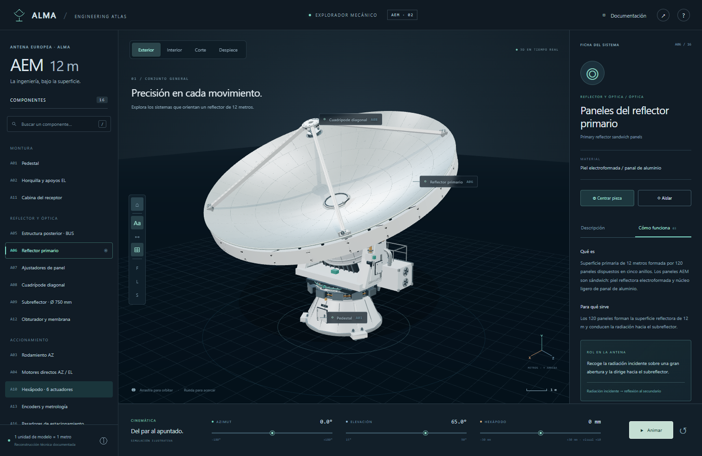

# ALMA 3D

Explorador mecánico de la antena europea **AEM de 12 metros** de ALMA.

## Abrir directamente

**[▶ Ejecutar ALMA 3D en el navegador](https://javierah306-tech.github.io/ALMA-3D/)**

No se necesita instalar Node.js, abrir CMD ni ejecutar comandos. Se requiere un navegador moderno con WebGL 2 y aceleración gráfica.

### Usar una copia local sin comandos

1. Descarga este repositorio desde **Code → Download ZIP**.
2. Descomprime la carpeta completa.
3. Abre **`ABRIR-ALMA-3D.html`** con doble clic en Edge, Chrome o Firefox.

Ese HTML integra todas las bibliotecas JavaScript y los estilos para evitar las restricciones de módulos de `file://`. Conserva las carpetas del ZIP para consultar imágenes, informe y parámetros. El visor funciona sin Internet; los enlaces a fuentes externas requieren conexión. `index.html` es la entrada del alojamiento web y no es la entrada local.

## Qué puedes explorar

- 16 sistemas A01–A16, con descripción, función, rol y principio de funcionamiento.
- 48 etapas de funcionamiento, 64 elementos y navegación entre sistemas relacionados.
- 120 paneles, cinco anillos y diámetro primario de 12 m.
- Vistas exterior, interior transparente, corte y despiece.
- Selección, aislamiento y primeros planos de mecanismos.
- Cinemática AZ/EL, enfoque del hexápodo y obturador ilustrativo.
- Exportación GLB en metros e imágenes PNG.

Arrastra para orbitar, rueda para acercar y botón derecho para desplazar. `H` restablece la cámara, `/` busca y `Esc` sale del aislamiento.

## Proyecto y contexto

| Ruta | Contenido |
|---|---|
| `index.html`, `app.js`, `styles.css` | Aplicación web |
| `model.js`, `precision.js` | Geometría y detalles mecánicos |
| `data.js`, `education.js` | Parámetros y fichas técnicas |
| `ABRIR-ALMA-3D.html` | Versión integrada para doble clic |
| `assets/` | Informe original y referencias visuales |
| `models/` | GLB y capturas |
| `docs/CONTEXTO.md` | Requisitos, evolución y decisiones |
| `docs/INFORME-IMPLEMENTACION.md` | Alcance y documentación técnica |
| `specification.json` | Datos documentados y reconstruidos |
| `vendor/` | Three.js y licencia MIT original |

## Precisión y créditos

Es una reconstrucción técnica y cinemática para estudio, no un CAD certificado ni un gemelo conectado a telemetría. Los detalles sin cotas OEM están identificados como representativos. El rango del hexápodo y su amplificación ×10 son ilustrativos.

Plano: **ESO/AEM Consortium**, antd-3300000 (2012). Fotografía de referencia: **NAOJ**, reproducida en el informe. El PDF y las imágenes conservan sus créditos y condiciones originales; su inclusión no concede una licencia adicional sobre material de terceros. Three.js se distribuye con su licencia MIT en `vendor/THREE-LICENSE.txt`. No es una aplicación oficial de ALMA, ESO o AEM.

## Desarrollo (opcional)

Los visitantes no necesitan estas herramientas. Para modificar y regenerar el HTML integrado: instalar las dependencias de desarrollo y ejecutar `npm run build:portable`. Después publicar los archivos en la rama `main`; GitHub Pages sirve la raíz. Las fuentes siguen siendo editables por separado.
